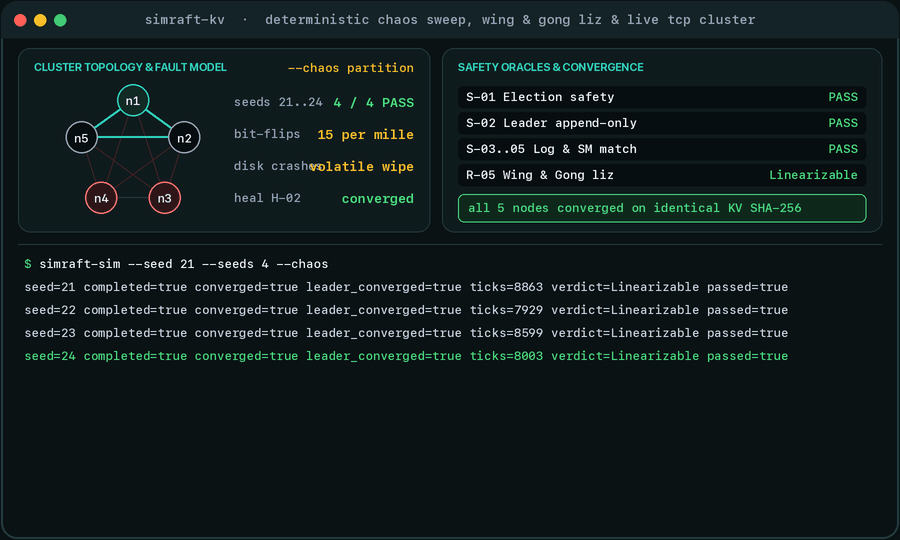

<p align="center">
  <a href="https://github.com/david-engelmann/simraft-kv">
    <picture>
      <source media="(prefers-color-scheme: dark)" srcset="https://raw.githubusercontent.com/david-engelmann/simraft-kv/main/docs/media/simraft-lockup-dark.svg">
      
    </picture>
  </a>
</p>

<h3 align="center">Sans-I/O Raft consensus engine, deterministic chaos simulator, and linearizable key-value store in Rust.</h3>

<p align="center">
  <code>simraft-kv</code> separates consensus logic from all network, disk, and clock I/O. One pure state machine (<code>Node::step</code>) and one checksummed wire codec (<code>"SRKV"</code>) power both a single-seed deterministic chaos simulator and a multi-process TCP and file-backed key-value server.
</p>

<p align="center">
  <a href="https://david-engelmann.github.io/simraft-kv/"><b>Docs</b></a> ·
  <a href="https://github.com/david-engelmann/simraft-kv/tree/main/examples">Examples</a> ·
  <a href="https://github.com/david-engelmann/simraft-kv/blob/main/docs/ARCHITECTURE.md">Architecture</a> ·
  <a href="https://github.com/david-engelmann/simraft-kv/blob/main/docs/INVARIANTS.md">Invariants</a> ·
  <a href="https://github.com/david-engelmann/simraft-kv/blob/main/SECURITY.md">Security</a> ·
  <a href="https://github.com/david-engelmann/simraft-kv/releases">Releases</a>
</p>

<p align="center">
  <a href="https://github.com/david-engelmann/simraft-kv/actions/workflows/ci.yml?query=branch%3Amain"></a>
  <a href="https://crates.io/crates/simraft-core"></a>
  <a href="https://pypi.org/project/simraft-kv/"></a>
  <a href="https://docs.rs/simraft-core"></a>
  <a href="https://github.com/david-engelmann/simraft-kv/blob/main/Cargo.toml"></a>
  <a href="https://github.com/david-engelmann/simraft-kv/blob/main/LICENSE-MIT"></a>
</p>

<p align="center">
  
</p>

<p align="center"><sub>Every terminal line above comes from real runs of <code>simraft-sim</code>, the <code>embed</code> example, and <code>simraft-node</code>.</sub></p>

## Why simraft-kv

Distributed consensus bugs hide in rare interleavings of asymmetric partitions, crash recoveries with unpersisted tails, stale durability acknowledgments after log truncation, and corrupted wire frames. Testing Raft only over live sockets makes those interleavings slow to trigger and nearly impossible to replay. `simraft-kv` makes every transition a pure function of explicit events so thousands of hostile cluster histories can be explored and replayed byte for byte from a single 64-bit integer.

- **Pure sans-I/O consensus core.** `simraft-core` has zero external dependencies, reads no ambient clock or randomness, and emits explicit `Action` values (`Send`, `PersistHardState`, `PersistEntries`, `Apply`, `ReadReady`, `ClientResponse`, `PersistSnapshot`, `LoadSnapshot`) in deterministic order.
- **Complete operational Raft protocol.** Implements Pre-Vote elections with leader recency denial (`T-03..T-05`), Figure 8 commitment (`S-06`), term-boundary conflict fast backup (`S-08`), clock-free `ReadIndex` quorum reads (`R-01..R-04`), chunked `InstallSnapshot` transfer (`N-01..N-08`), and single-server voter and learner membership changes (`M-01..M-05`).
- **Durability-gated transitions.** Votes, append acknowledgments, snapshot responses, single-voter commits, and `ReadIndex` releases wait until required `HardState` and log watermarks reach durable storage, clamping watermarks and fencing stale acks across log truncations (`T-02`, `R-06`).
- **Per-event safety oracles and Wing and Gong linearizability.** `simraft-sim` checks Election Safety, Leader Append-Only, Log Matching, Leader Completeness, and State Machine Safety after every simulator event, verifies completed client histories with a per-key Wing and Gong linearizability checker, and enforces post-heal leader and state digest convergence (`H-02`).
- **Shared wire codec across simulator and TCP.** `simraft-wire` frames every peer and client message with `"SRKV"` magic, 16 MiB defensive bounds, trailing-byte rejection, and IEEE CRC-32 checksums, exercised identically under simulated bit-flips and live sockets.

<p align="center">
  <picture>
    <source media="(prefers-color-scheme: dark)" srcset="https://raw.githubusercontent.com/david-engelmann/simraft-kv/main/docs/media/determinism-proof-dark.svg">
    
  </picture>
</p>

## How it works

<p align="center">
  <picture>
    <source media="(prefers-color-scheme: dark)" srcset="https://raw.githubusercontent.com/david-engelmann/simraft-kv/main/docs/media/how-it-works-dark.svg">
    
  </picture>
</p>

| Crate | Kind | External runtime deps | Role |
| --- | --- | --- | --- |
| [`simraft-core`](https://github.com/david-engelmann/simraft-kv/blob/main/simraft-core/README.md) | library | none (`std` only) | Pure sans-I/O Raft state machine (`Node::step`), Pre-Vote elections, fast log backup, Figure 8 commitment, `ReadIndex`, chunked snapshots, and single-server membership changes. |
| [`simraft-wire`](https://github.com/david-engelmann/simraft-kv/blob/main/simraft-wire/README.md) | library | `crc32fast` | Canonical `"SRKV"` message frame, log entry, and cluster config codec with 16 MiB frame bounds and IEEE CRC-32 checksums. |
| [`simraft-kv`](https://github.com/david-engelmann/simraft-kv/blob/main/simraft-kv/README.md) | library | none (`std` only) | Deterministic `BTreeMap` key-value state machine, bounded client session deduplication, and SHA-256 verified snapshot payloads. |
| [`simraft-node`](https://github.com/david-engelmann/simraft-kv/blob/main/simraft-node/README.md) | library and binary | `clap`, `crc32fast` | File-backed durable store, TCP peer transport, `serve` daemon, linearizable `client` CLI (`put`, `get`, `delete`), and static `completions` generator. |
| [`simraft-sim`](https://github.com/david-engelmann/simraft-kv/blob/main/simraft-sim/README.md) | library and binary | `clap`, `crc32fast`, `sha2` | Single-threaded deterministic simulator, seeded `--chaos` fault injector, per-event safety oracles, and Wing and Gong linearizability checker. |

## Quickstart

Install prebuilt Linux or macOS release archives verified against `SHA256SUMS` with [`install.sh`](https://raw.githubusercontent.com/david-engelmann/simraft-kv/main/install.sh), build from crates.io or `cargo-binstall`, or install the simulator CLI, linearizable TCP client, and typed Python SDK from PyPI.

```sh
curl -fsSL https://raw.githubusercontent.com/david-engelmann/simraft-kv/main/install.sh | sh
# or compile from crates.io
cargo install simraft-node simraft-sim
# or install simraft-sim and the Python SDK from PyPI
pip install simraft-kv
```

Generate static shell completions for `bash`, `zsh`, `fish`, or `powershell` from either binary.

```sh
simraft-node completions zsh > ~/.zfunc/_simraft-node
simraft-sim --completions zsh > ~/.zfunc/_simraft-sim
```

```python
import simraft_kv

sweep = simraft_kv.simulate(seed=912, seeds=5, chaos=True)
assert sweep.all_passed
zsh_script = simraft_kv.completions("zsh", tool="simraft-sim")

# Connect directly to a live simraft-node TCP cluster (follows leader redirects
# and preserves (client_id, seq) session deduplication across retries)
client = simraft_kv.SimRaftClient(
    ["127.0.0.1:7001", "127.0.0.1:7002", "127.0.0.1:7003"]
)
client.put("greeting", "hello")
assert client.get_text("greeting") == "hello"
client.delete("greeting")
```

### Run a deterministic chaos sweep and replay a single seed

Sweep 25 seeds across asymmetric partitions, crashes, clock jumps, and wire bit-flip corruption, then replay seed `912` deterministically.

```sh
simraft-sim --seed 0 --seeds 25 --chaos
simraft-sim --seed 912 --seeds 1 --chaos --json
```

```json
{"seed":912,"completed":true,"converged":true,"leader_converged":true,"ticks":9292,"verdict":"linearizable","digest":"c8a282578b8f0c97569595cff000063cfa6dfd8f23fc41c6be10f4994bde7095","passed":true}
```

### Run a three-node localhost TCP cluster

Start three `simraft-node` servers in separate terminals.

```sh
simraft-node serve --id 1 --data-dir /tmp/srkv-1 \
  --member 1@127.0.0.1:7001 --member 2@127.0.0.1:7002 --member 3@127.0.0.1:7003

simraft-node serve --id 2 --data-dir /tmp/srkv-2 \
  --member 1@127.0.0.1:7001 --member 2@127.0.0.1:7002 --member 3@127.0.0.1:7003

simraft-node serve --id 3 --data-dir /tmp/srkv-3 \
  --member 1@127.0.0.1:7001 --member 2@127.0.0.1:7002 --member 3@127.0.0.1:7003
```

Write, read, and delete keys against any member. The client follows leader hints automatically and reads linearizably through `ReadIndex`.

```sh
simraft-node client --server 127.0.0.1:7001 put greeting hello
simraft-node client --server 127.0.0.1:7002 get greeting
simraft-node client --server 127.0.0.1:7003 delete greeting
```

`put` and `delete` print `ok` and exit `0`. `get` writes raw value bytes to standard output and exits `0` when present, exits `1` with `simraft-node: key not found` on standard error when absent, and exits `2` on transport, timeout, or cluster errors.

### Embed the sans-I/O core in Rust

Callers embedding `simraft-core` own sockets, storage, and timers while `Node::step` computes every state transition.

```rust
let actions = node.step(event);
for action in actions {
    // Send messages, persist durable state, apply committed entries,
    // or complete client proposals and reads in action order.
}
```

Run the self-contained single-file three-node embedding example.

```sh
cargo run -p simraft-core --example embed --locked
```

## Benchmarks and verification

Measured with the Criterion benchmarks in this repository on hosted runners (`2026-11-19` baseline plus `v0.2.0` allocation gate).

| Benchmark / Gate | Workload | Median / Bound | Throughput / Budget |
| --- | --- | --- | --- |
| `propose_commit_single` | Full propose and commit round on a 3-node cluster (32-byte entry) | `1.50 us` | `~668,000 rounds/s` |
| `propose_commit_batch_32` | Coalesced batch of 32 proposals released on one persist ack (`B-02`) | `85.5 us` | `~374,000 entries/s` |
| `follower_append_entries` | Follower stepping one `AppendEntries` RPC | `76 ns` | `~13.1M steps/s` |
| `follower_catchup_10k` | Empty follower catching up to a 10,000-entry leader log | `4.06 ms` | `~2.46M entries/s` |
| `step_allocations` (`L-03`) | Thread-local heap allocations inside `Node::step` | `0` (`Tick`), `2` (`RequestVote`), `4` (`AppendEntries`) | Budgets `4`, `4`, `7` |
| `checker_scale` (`L-04`) | Wing and Gong per-key linearizability decision over 100,000 ops across 64 keys | `100,000 states` | Memoized exact verdict |

Run the full verification suite locally on Rust `1.88` or newer (CI pins `1.100.0` and checks MSRV `1.88.0` across Linux, macOS, and Windows, plus 1,000 chaos seeds on PRs, 10,000 on `main`, and 100,000 weekly).

```sh
cargo fmt --all -- --check
cargo clippy --workspace --all-targets --all-features --locked -- -D warnings
PROPTEST_CASES=500 cargo test --workspace --all-features --locked
RUSTDOCFLAGS="-D warnings" cargo doc --workspace --no-deps --locked
cargo bench --workspace --locked -- --test
```

## Documentation

| If you want to... | Read |
| --- | --- |
| Browse the full guides, CLI and Python reference, and searchable handbook | [Published documentation site](https://david-engelmann.github.io/simraft-kv/) · [Documentation index](https://github.com/david-engelmann/simraft-kv/blob/main/docs/README.md) |
| Run copy-paste chaos sweeps, deterministic trace replays, and localhost clusters | [Runnable examples](https://github.com/david-engelmann/simraft-kv/tree/main/examples) · [Rust sans-I/O embed example](https://github.com/david-engelmann/simraft-kv/blob/main/simraft-core/examples/embed.rs) |
| Read the protocol state rules, `"SRKV"` byte tables, and digest domains | [Architecture](https://github.com/david-engelmann/simraft-kv/blob/main/docs/ARCHITECTURE.md) · [Decisions](https://github.com/david-engelmann/simraft-kv/blob/main/DECISIONS.md) |
| Audit every safety, durability, liveness, and determinism invariant | [Invariants and traceability matrix](https://github.com/david-engelmann/simraft-kv/blob/main/docs/INVARIANTS.md) |
| Compare `simraft-kv` with `tikv/raft-rs`, `openraft`, `etcd/raft`, and simulation harnesses | [How simraft-kv compares](https://github.com/david-engelmann/simraft-kv/blob/main/docs/COMPARISON.md) · [FAQ](https://github.com/david-engelmann/simraft-kv/blob/main/docs/FAQ.md) |
| Integrate AI coding agents or check workspace contributor invariants | [Agent integration guide](https://github.com/david-engelmann/simraft-kv/blob/main/AGENTS.md) |
| Explore individual workspace crates | [simraft-core](https://github.com/david-engelmann/simraft-kv/blob/main/simraft-core/README.md) · [simraft-wire](https://github.com/david-engelmann/simraft-kv/blob/main/simraft-wire/README.md) · [simraft-kv](https://github.com/david-engelmann/simraft-kv/blob/main/simraft-kv/README.md) · [simraft-node](https://github.com/david-engelmann/simraft-kv/blob/main/simraft-node/README.md) · [simraft-sim](https://github.com/david-engelmann/simraft-kv/blob/main/simraft-sim/README.md) |
| Check defensive bounds, fuzz targets, threat model, and release history | [Security policy](https://github.com/david-engelmann/simraft-kv/blob/main/SECURITY.md) · [Fuzz targets](https://github.com/david-engelmann/simraft-kv/tree/main/fuzz) · [Roadmap](https://github.com/david-engelmann/simraft-kv/blob/main/docs/ROADMAP.md) · [Changelog](https://github.com/david-engelmann/simraft-kv/blob/main/CHANGELOG.md) |

## Contributing

[CONTRIBUTING.md](https://github.com/david-engelmann/simraft-kv/blob/main/CONTRIBUTING.md) covers local verification commands, replaying failing chaos seeds, invariant traceability rules, and public copy standards. Participation follows the [Code of Conduct](https://github.com/david-engelmann/simraft-kv/blob/main/CODE_OF_CONDUCT.md).

## License

Licensed under either of [MIT](https://github.com/david-engelmann/simraft-kv/blob/main/LICENSE-MIT) or [Apache-2.0](https://github.com/david-engelmann/simraft-kv/blob/main/LICENSE-APACHE) at your option.
