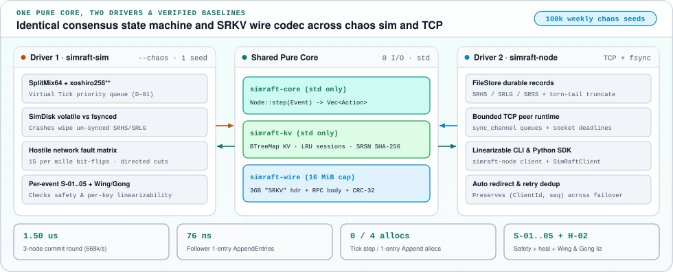
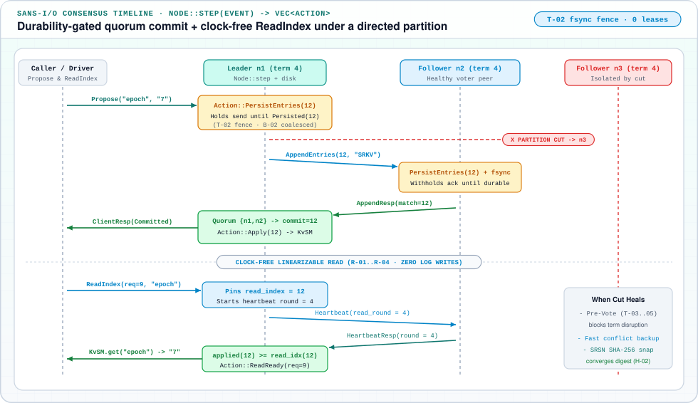

<div align="center">
  <picture>
    <source media="(prefers-color-scheme: dark)" srcset="https://raw.githubusercontent.com/david-engelmann/simraft-kv/main/docs/media/simraft-lockup-dark.svg">
    
  </picture>
  <p><strong>Sans-I/O Raft consensus core, single-seed chaos &amp; linearizability simulator, and durable TCP key-value cluster in Rust.</strong></p>
  <p>
    <a href="https://github.com/david-engelmann/simraft-kv/actions/workflows/ci.yml"></a>
    <a href="https://crates.io/crates/simraft-core"></a>
    <a href="https://crates.io/crates/simraft-node"></a>
    <a href="https://pypi.org/project/simraft-kv/"></a>
    <a href="https://docs.rs/simraft-core"></a>
    <a href="https://github.com/david-engelmann/simraft-kv/blob/main/LICENSE-MIT"></a>
  </p>
  <p>
    <a href="https://david-engelmann.github.io/simraft-kv/">Documentation Book</a> ·
    <a href="https://github.com/david-engelmann/simraft-kv/blob/main/docs/ARCHITECTURE.md">Architecture</a> ·
    <a href="https://github.com/david-engelmann/simraft-kv/blob/main/docs/INVARIANTS.md">Invariants</a> ·
    <a href="https://github.com/david-engelmann/simraft-kv/blob/main/docs/COMPARISON.md">Comparison</a> ·
    <a href="https://github.com/david-engelmann/simraft-kv/blob/main/docs/FAQ.md">FAQ</a> ·
    <a href="https://github.com/david-engelmann/simraft-kv/tree/main/examples">Examples</a>
  </p>
</div>

<p align="center">
  
</p>

`simraft-kv` keeps consensus state transitions strictly separate from sockets, files, threads, and clocks. Every state transition in `simraft-core` is a pure function `Node::step(&mut self, Event) -> Vec<Action>` over the Rust standard library (`#![forbid(unsafe_code)]`, zero external crates). That boundary lets one deterministic simulator (`simraft-sim`) step hostile five-node fault histories at thousands of virtual ticks per second on one thread while the production TCP daemon (`simraft-node`) runs the exact same core and `"SRKV"` wire codec across OS processes.

---

## One Pure State Machine, Two Drivers

<p align="center">
  <picture>
    <source media="(prefers-color-scheme: dark)" srcset="https://raw.githubusercontent.com/david-engelmann/simraft-kv/main/docs/media/dual-driver-chaos-dark.svg">
    
  </picture>
</p>

Embedding `simraft-core` requires no async runtime or trait hierarchy. Your driver owns transport, timers, and disk flushes, feeding `Event` values in and executing returned `Action` values in order:

```rust
use simraft_core::{Action, ClusterConfig, Config, Event, Node, NodeId, PersistKind, Tick};

let voters = [NodeId(1), NodeId(2), NodeId(3)].into_iter().collect();
let mut node = Node::new(NodeId(1), Config::default(), ClusterConfig::new(voters, Default::default())?)?;

for action in node.step(Event::Tick { now: Tick(320) }) {
    match action {
        Action::PersistHardState { current_term, voted_for } => {
            // fsync HardState to durable storage, then acknowledge:
            let _ = (current_term, voted_for);
            let _follow_up = node.step(Event::Persisted {
                kind: PersistKind::HardState,
                up_to_index: simraft_core::LogIndex(0),
            });
        }
        Action::PersistEntries { from_index, entries } => { /* fsync log batch, step Persisted */ let _ = (from_index, entries); }
        Action::Send { to, msg } => { /* encode via simraft_wire::encode_frame and transmit */ let _ = (to, msg); }
        Action::Apply { index, entry } => { /* apply committed entry to KvStateMachine */ let _ = (index, entry); }
        Action::ReadReady { request_id, key, read_index } => { /* serve linearizable read */ let _ = (request_id, key, read_index); }
        _ => {}
    }
}
```

See [`simraft-core/examples/embed.rs`](https://github.com/david-engelmann/simraft-kv/blob/main/simraft-core/examples/embed.rs) (`cargo run -p simraft-core --example embed`) for a self-contained three-node driver in ~120 lines of Rust.

---

## Durability-Gated Quorum & Clock-Free `ReadIndex`

<p align="center">
  <picture>
    <source media="(prefers-color-scheme: dark)" srcset="https://raw.githubusercontent.com/david-engelmann/simraft-kv/main/docs/media/step-quorum-timeline-dark.svg">
    
  </picture>
</p>

`simraft-core` enforces durability and linearizability inside the state machine rather than trusting outer runtime conventions:

1. **Durability watermarks (`T-02`, `B-02`, `R-06`).** A node withholds vote grants, `AppendEntries` acknowledgments, held leader replication batches, single-voter commits, and `ReadReady` notifications until matching `PersistHardState` and `PersistEntries` actions are acknowledged via `Event::Persisted`. Multiple proposals arriving while a flush is in flight coalesce into one outbound batch per follower (`B-02`).
2. **Pre-Vote with leader recency (`T-03..T-05`).** Election timeouts enter `PreCandidate` first without incrementing persistent `current_term`, and voters reject pre-votes while hearing from a current-term leader within `min_election_timeout`, preventing partitioned nodes from disrupting healthy quorums on rejoin.
3. **Figure 8 & verified-prefix follower commits (`S-05`, `S-06`, `S-08`).** Leaders count quorum replication strictly on `current_term` entries, followers emit per-term fast-backup hints `(conflict_index, conflict_term)` on mismatches, and follower `commit_index` advances only up to `min(leader_commit, prev_log_index + entries.len())` so an empty heartbeat never commits unverified divergent entries.
4. **Clock-free linearizable reads (`R-01..R-04`).** `Event::ReadIndex` uses zero wall-clock or virtual-clock leader leases: the leader waits for its current-term `NoOp` if needed, records `read_index = commit_index`, confirms quorum leadership via a monotonic `read_round` heartbeat exchange (zero log writes, `L-01`), and emits `Action::ReadReady` once `last_applied >= read_index`.
5. **Single-server membership & SHA-256 snapshots (`M-01..M-05`, `N-01..N-08`).** Supports `AddLearner`, `PromoteVoter` (gated on `match_index >= commit_index`), and `RemoveVoter` one server at a time, plus chunked `InstallSnapshot` transfer verified against FIPS 180-4 SHA-256 (`"simraft-kv/snapshot/v1"`).

---

## Chaos Simulation, Single-Seed Replay, and Live TCP Cluster

### Install

```sh
# Prebuilt Linux / macOS binaries (simraft-node + simraft-sim) verified against SHA256SUMS
curl -fsSL https://raw.githubusercontent.com/david-engelmann/simraft-kv/main/install.sh | sh

# Python 3.10+ SDK + bundled binaries
pip install simraft-kv

# Cargo / cargo-binstall
cargo install simraft-node simraft-sim
```

### Run a deterministic `--chaos` sweep and replay any seed

`simraft-sim --chaos` injects seeded packet drops/duplicates, variable latency, `15` per mille `"SRKV"` frame bit-flips, crashes that wipe volatile un-fsynced `SimDisk` state, virtual clock jumps, and asymmetric directed partitions, checking `S-01..S-05` after every event and running a memoized per-key Wing and Gong linearizability check (`R-05`) after bounded healing (`H-02`):

```sh
# Run 20 chaos seeds and emit one JSON verdict line per seed
simraft-sim --seed 912 --seeds 20 --chaos --json

# Replay a single seed byte-for-byte with full event trace output
simraft-sim --seed 912 --seeds 1 --chaos --trace
```

### Operate a three-node localhost TCP cluster

```sh
simraft-node serve --id 1 --data-dir /tmp/sr-1 \
  --member 1@127.0.0.1:7001 --member 2@127.0.0.1:7002 --member 3@127.0.0.1:7003 &
simraft-node serve --id 2 --data-dir /tmp/sr-2 \
  --member 1@127.0.0.1:7001 --member 2@127.0.0.1:7002 --member 3@127.0.0.1:7003 &
simraft-node serve --id 3 --data-dir /tmp/sr-3 \
  --member 1@127.0.0.1:7001 --member 2@127.0.0.1:7002 --member 3@127.0.0.1:7003 &

simraft-node client --server 127.0.0.1:7001 put config/epoch 7
simraft-node client --server 127.0.0.1:7002 get config/epoch   # follower redirect -> linearizable ReadIndex read
simraft-node client --server 127.0.0.1:7003 delete config/epoch
```

### Drive both from Python (`simraft_kv`)

```python
import simraft_kv

sweep = simraft_kv.simulate(seed=912, seeds=5, chaos=True)
assert sweep.all_passed

client = simraft_kv.SimRaftClient(
    ["127.0.0.1:7001", "127.0.0.1:7002", "127.0.0.1:7003"],
    timeout=10.0,
)
client.put("task/owner", "worker-1")
assert client.get_text("task/owner") == "worker-1"  # caches leader & preserves (client_id, seq) on retry
```

---

## Measured Baselines, Wire Schemas, and Crates

Recorded Criterion and counting-allocator baselines (`simraft-core/benches/step_allocations.rs`, `L-01..L-04`):

| Path | Median / Budget | Notes |
| --- | --- | --- |
| Direct 3-node proposal + durability + commit round | `1.50 us` (~`668k` rounds/s) | In-memory `Node::step` loop across 3 voter instances. |
| Follower 1-entry `AppendEntries` step | `76 ns` (`4` heap allocs) | Includes log append, `PersistEntries`, and response framing. |
| Idle `Event::Tick` step | `0` heap allocations | Enforced by thread-local counting allocator gate (`L-03`). |
| Scheduled CI chaos campaign | `100,000` seeds / week | `.github/workflows/weekly-sweep.yml` across `--chaos` fault matrix. |

All wire and disk records use fixed little-endian headers, a `16 MiB` defensive payload ceiling (`E-01`), and explicit checksum domain tags (`"SRKV/frame/v1"`, `"SRKV/hard/v1"`, `"SRKV/log/v1"`, `"SRKV/snap/v1"`, `"simraft-kv/snapshot/v1"`).

| Crate | External runtime deps | Role |
| --- | --- | --- |
| [`simraft-core`](https://github.com/david-engelmann/simraft-kv/blob/main/simraft-core/README.md) | None (`std` only) | Sans-I/O Raft state machine (`Node::step`), Pre-Vote, `ReadIndex`, chunked snapshots, and single-server config changes. |
| [`simraft-kv`](https://github.com/david-engelmann/simraft-kv/blob/main/simraft-kv/README.md) | None (`std` only) | Deterministic `BTreeMap` state machine, LRU `(ClientId, seq)` session table, and SHA-256 `"SRSN"` snapshot codec. |
| [`simraft-wire`](https://github.com/david-engelmann/simraft-kv/blob/main/simraft-wire/README.md) | `crc32fast` | 36-byte `"SRKV"` peer message frame, log entry, and cluster config codec with IEEE CRC-32 checksums. |
| [`simraft-node`](https://github.com/david-engelmann/simraft-kv/blob/main/simraft-node/README.md) | `clap`, `crc32fast` | Durable `"SRHS"` / `"SRLG"` / `"SRSS"` `FileStore`, TCP peer & client daemon, and `client` / `completions` CLI. |
| [`simraft-sim`](https://github.com/david-engelmann/simraft-kv/blob/main/simraft-sim/README.md) | `clap`, `crc32fast`, `sha2` | Deterministic virtual-clock harness, `--chaos` fault injector, `S-01..S-05` oracles, and Wing & Gong checker. |

- **Specifications & Traceability:** [Published Documentation Book](https://david-engelmann.github.io/simraft-kv/) · [`docs/ARCHITECTURE.md`](https://github.com/david-engelmann/simraft-kv/blob/main/docs/ARCHITECTURE.md) · [`docs/INVARIANTS.md`](https://github.com/david-engelmann/simraft-kv/blob/main/docs/INVARIANTS.md)
- **Comparisons, Examples & Policies:** [`docs/COMPARISON.md`](https://github.com/david-engelmann/simraft-kv/blob/main/docs/COMPARISON.md) · [`docs/FAQ.md`](https://github.com/david-engelmann/simraft-kv/blob/main/docs/FAQ.md) · [`examples/`](https://github.com/david-engelmann/simraft-kv/tree/main/examples) · [`fuzz/`](https://github.com/david-engelmann/simraft-kv/tree/main/fuzz) · [`AGENTS.md`](https://github.com/david-engelmann/simraft-kv/blob/main/AGENTS.md) · [`SECURITY.md`](https://github.com/david-engelmann/simraft-kv/blob/main/SECURITY.md)

## License

Licensed under either of [Apache License, Version 2.0](https://github.com/david-engelmann/simraft-kv/blob/main/LICENSE-APACHE) or [MIT License](https://github.com/david-engelmann/simraft-kv/blob/main/LICENSE-MIT), at your option.
