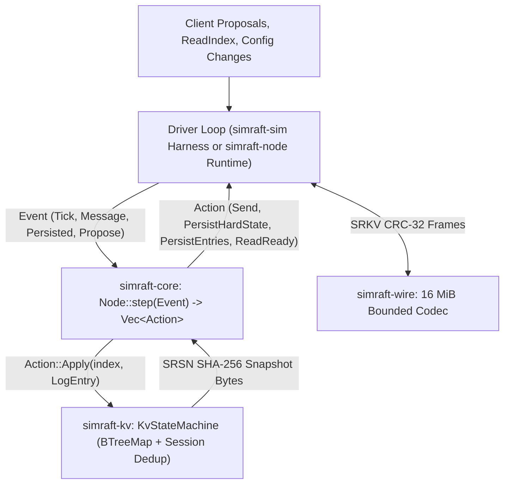

# simraft-kv

  
  

**Sans-I/O Raft consensus engine, deterministic chaos simulator, and linearizable key-value store in Rust.**

`simraft-kv` separates consensus logic from all network, disk, and clock I/O. One pure state machine (`Node::step`) and one checksummed wire codec (`"SRKV"`) power both a single-seed deterministic chaos simulator (`simraft-sim`) and a multi-process TCP and file-backed key-value server (`simraft-node`).

  

## Why simraft-kv

Distributed consensus bugs hide in rare interleavings of asymmetric partitions, crash recoveries with unpersisted tails, stale durability acknowledgments after log truncation, and corrupted wire frames. Testing Raft only over live OS sockets makes those interleavings slow to trigger and difficult to reproduce. `simraft-kv` makes every consensus transition a pure function of explicit events so hostile cluster histories can be explored at thousands of virtual ticks per second and replayed byte for byte from a single 64-bit integer seed.

- **Pure sans-I/O consensus core (`simraft-core`)**: zero external dependencies (`std` only), `#![forbid(unsafe_code)]`, and deterministic `Event -> Vec<Action>` execution with verified heap allocation budgets (`L-03`).
- **Complete operational Raft protocol**: Pre-Vote elections with leader recency denial (`T-03..T-05`), Figure 8 commitment (`S-06`), fast conflict backup (`S-08`), clock-free `ReadIndex` quorum reads (`R-01..R-04`), chunked `InstallSnapshot` transfer (`N-01..N-08`), and single-server voter and learner membership changes (`M-01..M-05`).
- **Durability-gated transitions**: vote grants, append acknowledgments, snapshot responses, single-voter commits, and `ReadIndex` releases wait until required `HardState` and log watermarks are acknowledged durable (`T-02`, `R-06`).
- **Continuous safety oracles and linearizability verification**: `simraft-sim` checks `S-01..S-05` after every simulator event, verifies post-heal leader and state digest convergence (`H-02`), and runs a memoized per-key Wing and Gong linearizability checker (`R-05`, `L-04`).
- **Shared wire codec across simulator and TCP**: `simraft-wire` frames every peer RPC with `"SRKV"` magic, 16 MiB defensive length bounds, trailing-byte rejection, and domain-separated IEEE CRC-32 checksums (`"SRKV/frame/v1"`).

## Architecture at a glance

## Workspace crates

| Crate | Kind | External runtime deps | Role |
| --- | --- | --- | --- |
| [`simraft-core`](https://github.com/david-engelmann/simraft-kv/blob/main/simraft-core/README.md) | library | none (`std` only) | Pure sans-I/O Raft state machine (`Node::step`), Pre-Vote elections, fast log backup, Figure 8 commitment, `ReadIndex`, chunked snapshots, and single-server membership changes. |
| [`simraft-wire`](https://github.com/david-engelmann/simraft-kv/blob/main/simraft-wire/README.md) | library | `crc32fast` | Canonical `"SRKV"` message frame, log entry, and cluster config codec with 16 MiB bounds and IEEE CRC-32 checksums. |
| [`simraft-kv`](https://github.com/david-engelmann/simraft-kv/blob/main/simraft-kv/README.md) | library | none (`std` only) | Deterministic `BTreeMap` key-value state machine, bounded client session deduplication, and SHA-256 verified `"SRSN"` snapshots. |
| [`simraft-node`](https://github.com/david-engelmann/simraft-kv/blob/main/simraft-node/README.md) | library and binary | `clap`, `crc32fast` | File-backed durable store, TCP peer transport, `serve` daemon, linearizable `client` CLI (`put`, `get`, `delete`), and shell `completions`. |
| [`simraft-sim`](https://github.com/david-engelmann/simraft-kv/blob/main/simraft-sim/README.md) | library and binary | `clap`, `crc32fast`, `sha2` | Single-threaded deterministic simulator, seeded `--chaos` fault injector, per-event safety oracles, and Wing and Gong linearizability checker. |

## Where to go next

| If you want to... | Read |
| --- | --- |
| Install binaries or Python packages and run your first sweep or TCP cluster | [Quickstart](./quickstart.md) |
| Look up CLI flags, exit codes, JSON schemas, and `simraft_kv` Python APIs | [CLI, TCP Cluster, and Python SDK](./cli-and-python.md) |
| Run copy-paste chaos sweep, trace replay, and localhost cluster scripts | [Runnable examples on GitHub](https://github.com/david-engelmann/simraft-kv/tree/main/examples) |
| Inspect roles, state transitions, `"SRKV"` byte layouts, and digest domains | [Architecture](docs/ARCHITECTURE.md) |
| Audit every safety, durability, liveness, and determinism invariant | [Invariants and Traceability](docs/INVARIANTS.md) |
| Compare `simraft-kv` with `tikv/raft-rs`, `openraft`, and `etcd/raft` | [How simraft-kv Compares](docs/COMPARISON.md) |
| Check common questions on sans-I/O, `ReadIndex`, durability, and TLS scope | [FAQ](docs/FAQ.md) |
| Integrate an AI coding agent with the repository or binaries | [AGENTS.md](https://github.com/david-engelmann/simraft-kv/blob/main/AGENTS.md) |
| Review security bounds, fuzzing harnesses, and release history | [SECURITY.md](https://github.com/david-engelmann/simraft-kv/blob/main/SECURITY.md) · [fuzz/](https://github.com/david-engelmann/simraft-kv/tree/main/fuzz) · [CHANGELOG.md](https://github.com/david-engelmann/simraft-kv/blob/main/CHANGELOG.md) |
